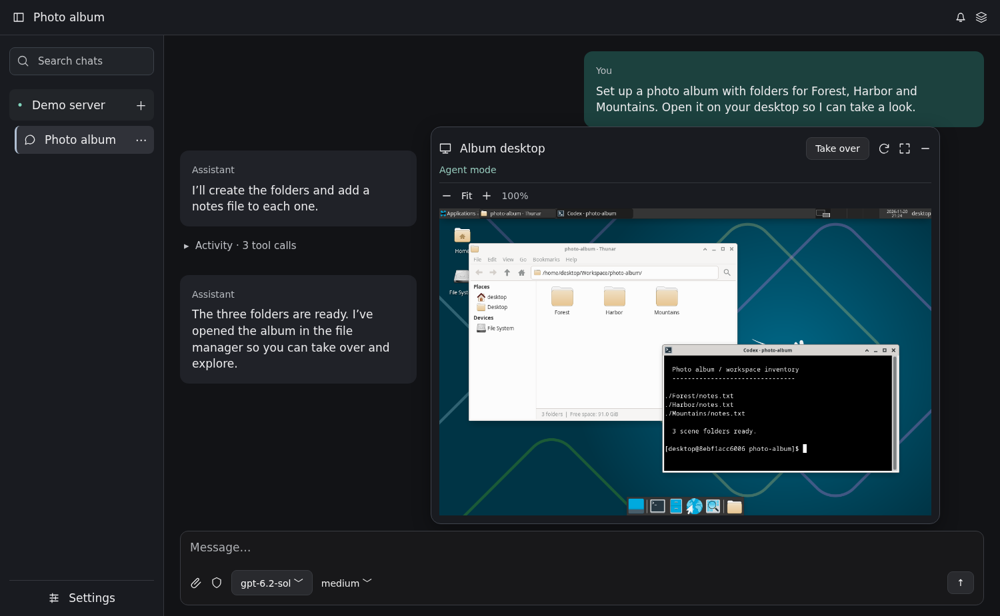

<p align="center"></p>

# D4C

**Give Codex a desktop on your own server.** Chat from Linux, Windows, or Android, watch it work live, and take over from your phone.

D4C is a native Rust client for Codex App Server. Follow tool calls as they happen, schedule recurring tasks, and switch between servers from one sidebar. Your sessions stay on the server, so you can start a task on your laptop, close the app, and pick it up on Android.

Downloads are available for Android arm64, Linux x86_64, and Windows x86_64.

## Watch Codex use its desktop

Each D4C desktop has its own Linux home directory and graphical session. Codex can open a terminal, work on files and use graphical apps there. Open the desktop from chat to watch live or take over the mouse and keyboard.



*Illustrated D4C session with a fictional chat and a real desktop capture from an isolated photo-album demo.*

## Get started

1. Install the D4C manager and Codex CLI on your host, then sign in to Codex under the service account. Follow the [server installation guide](INSTALL.md).
2. Download the Android arm64 APK, Linux x86_64 archive, or Windows x86_64 ZIP from [Releases](https://github.com/BLig-Vox/D4C/releases).
3. In **Settings → Add server**, enter the server name and private WSS URL. Existing installations keep their saved server addresses.
4. On a new device, compare its displayed fingerprint and approve the matching ID on the server using `d4c-server --approve DEVICE_ID`.

Select a chat under its server in the sidebar. Returning to a visited server reuses a healthy chat connection and fetches recent history. **Settings → Workspace server** sets an optional endpoint for desks and drafts. The default uses the same hostname on port 8443.

On Linux x86_64, with GStreamer installed, you can install the prebuilt client without compiling using [cargo-binstall](https://github.com/cargo-bins/cargo-binstall):

```sh
cargo binstall --git https://github.com/BLig-Vox/D4C.git --version 0.1.2 vox-d4c
```

On Windows, extract the entire ZIP and run `bin\vox-d4c.exe`. On desktop, open **Settings → System update** to check Stable or Alpha releases for your platform. **Download** opens the matching archive in your browser. Close D4C and extract the new package to upgrade.

## Host setup from Codex to Tailscale

One Linux host runs one D4C manager and one persistent Codex app server. A phone or desktop client opens a private WebSocket to the manager over Tailscale. The manager authenticates the device and forwards chat to Codex over a local Unix socket. The host keeps the threads, scheduled jobs and desktop environments when a client closes. Repeat the setup on each host you want in the sidebar.

**Choose the right starting point.** The steps below assume a fresh host. For an existing native Codex installation with missing chat images, skip to [upgrading the manager](#upgrade-the-manager-and-verify-chat-images). To import conversations from an older installation, follow the snapshot and import steps in the [migration guide](docs/setup.md) **before** creating the Codex workspace.

### 1. Join the private network

Install Tailscale on the server and on each client. On a fresh Linux server, run the commands below and complete the sign-in. In the tailnet DNS settings, enable MagicDNS and HTTPS certificates. Allow the intended client devices to reach the server on TCP 8443 in your tailnet policy and host firewall. D4C terminates TLS on the server’s tailnet address. This setup needs no public port forwarding. [Tailscale installation](https://tailscale.com/download) · [MagicDNS](https://tailscale.com/docs/features/magicdns) · [HTTPS certificates](https://tailscale.com/docs/how-to/set-up-https-certificates)

```sh
sudo systemctl enable --now tailscaled
sudo tailscale up
tailscale status
d4c_ip=$(tailscale ip -4)
d4c_dns=$(tailscale status --json | python3 -c 'import json,sys; print(json.load(sys.stdin)["Self"]["DNSName"].rstrip("."))')
printf 'D4C chat URL: wss://%s:8443/codex\n' "$d4c_dns"
```

Use the full DNS name printed here in the client so the name matches the TLS certificate. Keep these shell variables for step 3. On Android, connect the Tailscale app to the same tailnet.

### 2. Install the server release and prerequisites

Use an x86_64 Linux host with systemd, Python 3, Node.js and npm. For desktops, install rootless Podman with Quadlet, pasta, subordinate UID/GID support and a user D-Bus session. For scheduled jobs, install the Python packages providing `croniter` and `websocket` (websocket-client). The packaged units were exercised with systemd 262 and Codex CLI 0.169.0.

Download the **server** archive and `SHA256SUMS` from the same release into one directory. Run the remaining setup commands from inside the extracted archive. [D4C alpha.14 downloads](https://github.com/BLig-Vox/D4C/releases/tag/v0.1.0-alpha.14)

```sh
archive=d4c-server-0.1.0-alpha.14-linux-x86_64.tar.gz
awk -v f="$archive" '$2 == f' SHA256SUMS | sha256sum -c - &&
  tar -xzf "$archive" && cd "${archive%.tar.gz}"
```

```sh
sudo useradd --create-home --shell /bin/bash d4c
sudo loginctl enable-linger d4c
sudo npm install --global --prefix /usr @openai/codex@0.169.0
/usr/bin/codex --version
/usr/bin/python3 -c 'import croniter, websocket'
sudo install -m 0755 bin/vox-d4c-server /usr/local/bin/d4c-server
```

For desktops, ensure the service account has non-overlapping ranges in `/etc/subuid` and `/etc/subgid`. Build the image as that user from a directory readable by it. An image in root’s Podman store is invisible to the desktop manager.

```sh
d4c_uid=$(id -u d4c)
sudo -u d4c env HOME="$(getent passwd d4c | cut -d: -f6)" XDG_RUNTIME_DIR="/run/user/$d4c_uid" \
  DBUS_SESSION_BUS_ADDRESS="unix:path=/run/user/$d4c_uid/bus" \
  podman build -t localhost/d4c-arch-xfce:1 server/desktop
```

### 3. Configure the private WSS listener

Render the configuration for this host, then install the files and request its first TLS certificate. The weekly timer enabled in step 4 renews the certificate and restarts the manager to load it.

```sh
python3 scripts/configure-server.py --hostname "$d4c_dns" --listen "$d4c_ip:8443"
sudo install -d -m 0750 -o root -g d4c /etc/d4c /etc/d4c/tls
sudo install -d -m 0700 -o d4c -g d4c /var/lib/d4c /var/lib/d4c/codex /var/lib/d4c/uploads /var/lib/d4c/schedules
sudo install -m 0640 -o root -g d4c target/deploy/manager.json /etc/d4c/manager.json
sudo install -m 0644 target/deploy/*.service target/deploy/*.socket target/deploy/*.timer target/deploy/*.path /etc/systemd/system/
sudo install -m 0644 target/deploy/d4c-codex-tmpfiles.conf /etc/tmpfiles.d/d4c-codex.conf
sudo systemd-tmpfiles --create /etc/tmpfiles.d/d4c-codex.conf
sudo install -D -m 0755 server/scripts/d4c-scheduler.py /usr/local/libexec/d4c-scheduler
sudo install -D -m 0755 server/scripts/d4c-refresh-codex.py /usr/local/libexec/d4c-refresh-codex.py
sudo systemctl daemon-reload
sudo systemctl start d4c-certificate.service
```

### 4. Authenticate Codex and start the services

The packaged service runs as Unix user `d4c` with both `HOME` and `CODEX_HOME` set to `/var/lib/d4c/codex`. Run sign-in, MCP and skill setup under that identity. Signing in from an administrator’s own shell stores credentials in a different home.

```sh
d4c_codex=/var/lib/d4c/codex
sudo install -d -m 0700 -o d4c -g d4c "$d4c_codex/workspace" "$d4c_codex/skills" "$d4c_codex/skills/ponytail"
sudo install -m 0600 -o d4c -g d4c vendor/ponytail/skills/ponytail/SKILL.md vendor/ponytail/LICENSE "$d4c_codex/skills/ponytail/"
printf '%s\n' 'Use the bundled Ponytail skill in full mode by default for coding work. Honor requests to switch levels or turn Ponytail off.' \
  | sudo -u d4c tee -a "$d4c_codex/AGENTS.md" >/dev/null
sudo -u d4c env HOME="$d4c_codex" CODEX_HOME="$d4c_codex" /usr/bin/codex login status
```

If the status reports that sign-in is needed, run the following on this host. Open the URL displayed by the CLI, enter its device code in the browser, then wait for the terminal to confirm sign-in.

```sh
sudo -u d4c env HOME=/var/lib/d4c/codex CODEX_HOME=/var/lib/d4c/codex /usr/bin/codex login --device-auth
sudo -u d4c env HOME=/var/lib/d4c/codex CODEX_HOME=/var/lib/d4c/codex /usr/bin/codex login status
```

```sh
sudo systemctl enable --now d4c-certificate.timer d4c-manager.service d4c-codex.service d4c-scheduler.timer d4c-refresh.path
sudo systemctl is-active d4c-manager.service d4c-codex.service d4c-scheduler.timer d4c-refresh.path
sudo stat -Lc '%a %U %G %n' /run/d4c-codex/app.sock
```

The final command should show a mode-600 socket owned by `d4c`. Codex works in `/var/lib/d4c/codex/workspace`. **Full access (YOLO)** controls approval and sandboxing inside that service. Its operating-system permissions and systemd mount restrictions still apply, including `ProtectHome=yes`. Attaching a desktop gives the chat access to that desktop’s screen and input.

### 5. Pair each client with each host

1. In D4C, open **Settings → Add server**, give the host a recognizable name, and enter the WSS URL from step 1. Connect once to register a pending device.
2. On that host, list the pending devices. Compare the full fingerprint with the one displayed by the client.
3. Approve the matching ID and reconnect. Send a short message, reopen the thread, and check that its history loads.

```sh
sudo -u d4c /usr/local/bin/d4c-server --config /etc/d4c/manager.json --list-devices
# Replace DEVICE_ID with the fingerprint you just compared.
sudo -u d4c /usr/local/bin/d4c-server --config /etc/d4c/manager.json --approve DEVICE_ID
```

**Tailnet membership provides connectivity. D4C pairing grants access to a specific host.** Pair the phone and desktop app individually on every server they use. Switching between already-paired servers reuses the saved identities. Clearing client storage can create a new device fingerprint.

| Endpoint on the manager | Purpose |
| --- | --- |
| `wss://HOST:8443/codex` | Device-authenticated Codex chat |
| `wss://HOST:8443/control` | Workspace operations, including desktops and drafts |
| `wss://HOST:8443/vnc/<desktop-id>` | Attached desktop viewer opened by the client |

Existing clients with a saved chat port such as 8444 can keep it. With that port free and allowed by your tailnet policy, run `sudo systemctl enable --now d4c-chat@8444.socket`. This binds the relay to `tailscale0` and forwards TLS to the same manager. The workspace endpoint defaults to port 8443. [Existing ports and Tailscale Serve routes](docs/setup.md#connect-and-pair-devices)

### Upgrade the manager and verify chat images

**If chat says “Here’s the screenshot” but shows only text, check the running server version first.** On two deployments the clients already supported media, but both managers were still on alpha.8. Codex had captured the screenshots and saved the generated images. The older managers did not deliver the attachments. Chat media support shipped in alpha.11. Upgrading the managers to alpha.14 restored delivery with the existing client.

For this **alpha.8 → alpha.14 media fix**, use the verified server archive from step 2 on each host. Wait for a convenient reconnect window. The commands below back up the installed binary, replace it atomically and restart only the manager. They preserve the configuration, approvals, TLS identity, Codex threads and desktop volumes. Keep the backup path printed by the shell for rollback.

```sh
(
  set -eu
  binary=/usr/local/bin/d4c-server
  backup=$(sudo mktemp /usr/local/bin/d4c-server.previous.XXXXXXXX)
  sudo cp -p "$binary" "$backup"
  printf 'Rollback binary: %s\n' "$backup"
  staged=$(sudo mktemp /usr/local/bin/d4c-server.next.XXXXXXXX)
  sudo install -m 0755 bin/vox-d4c-server "$staged"
  sudo "$staged" --version
  sudo mv -f "$staged" "$binary"
  sudo systemctl restart d4c-manager
  systemctl is-active d4c-manager d4c-codex
  pid=$(systemctl show d4c-manager -p MainPID --value)
  sudo "/proc/$pid/exe" --version
)
```

The last command checks the **running process**. For this release it should print `d4c-server 0.1.0-alpha.14`. If the manager fails to start, inspect `sudo journalctl -u d4c-manager -n 50`. To roll back, copy the printed backup to a sibling staging file, replace the binary with `mv`, and restart `d4c-manager`.

**Verify from a fresh test chat** on the host you upgraded.

1. Connect an existing desktop in the chat workspace. Ask “Take a screenshot of the attached desktop and send it here.” Open the thumbnail and confirm the viewer displays that desktop.
2. With an image-generation-capable Codex setup, ask “Generate a green apple on a white plate and send it here.” Confirm the generated image appears inline and opens in the viewer.
3. Switch away and reopen the thread. Verify the attachments are still available from chat history.

After the alpha.14 server rollout, the Linux client on Tusk recovered an earlier desktop screenshot after reconnecting and opened a newly generated apple image. Doom’s manager version and service health were also checked. The visual test covered Tusk on Linux. For attachments above the manager’s 6 MB per-file limit, retry with a smaller image.

**Existing chats missing `share_media`.** Codex saves a tool list with each conversation. If a new chat can send a PNG but an older one only displays its server path, check whether the installed Codex unit has the tool refresh hook with `systemctl cat d4c-codex`. In builds with `--refresh-codex-tools`, the hook updates older conversations before Codex opens their transcripts. Install the matching unit and manager together, then restart Codex between turns. The original alpha.14 release archive predates this hook. [Service setup](docs/setup.md#set-up-the-working-directory-ponytail-and-authentication)

**Media links in Codex replies.** When `share_media` is unavailable, save the image or video in the current server thread’s export folder, `$CODEX_HOME/workspace/d4c-media/<thread-id>/`. Add `MEDIA: Demo video.mp4` in its own paragraph or use a Markdown link to the absolute file with the `sandbox:` prefix. The updated server and client display the attachment in live replies and when you reopen the chat. The fallback reads files up to 6 MB from that thread’s export folder.

### Connection troubleshooting

| Symptom | First check |
| --- | --- |
| Stuck connecting | Check Tailscale on both ends. From a Linux peer run `tailscale ping HOST`. Then check TCP policy, listener port and `systemctl status d4c-manager`. A successful peer ping alone does not test WSS. |
| TLS error | Use the full tailnet DNS name. Check `sudo journalctl -u d4c-certificate.service` and `systemctl status d4c-certificate.timer`. |
| Approval reminder | Run `--list-devices` on the selected host. Approve only the matching pending fingerprint. If it is already approved, check WSS connectivity. |
| Connected but model calls fail | Check Codex login status as the service account, the local socket from step 4 and `sudo journalctl -u d4c-codex -n 50`. |
| Chat works but the desktop does not | Check the selected workspace endpoint, the chat’s desktop binding and the rootless Podman image under user `d4c`. |
| Text arrives without images | Compare the running manager version on each host, check for an actual screenshot or image-generation tool result, and run the two media tests above. |


## Daily use

- **Chats:** start, search, rename or delete conversations in the sidebar, grouped under their server. Enter sends; Shift+Enter adds a line. The down-arrow returns to the latest message.
- **Models:** choose from the Codex server's model catalog in the composer. Your choice and reasoning level are remembered per connection. Availability comes from the server and your provider account.
- **Uploads:** use **+** or desktop drag-and-drop. Limits are 6 MB per file and 12 MB per draft. Sent images have previews; files have cards. Interpretation of audio, video and documents depends on the chosen runtime/model. Unsent attachments stay on their originating device.
- **Chat media:** Open a picture to zoom or pan. Attached videos have playback and seek controls. On Android, web links open in your browser. For assistant-generated media and screenshot previews, update the workspace server alongside the app.
- **Activity:** replies stream as Codex emits events. Tool calls have expandable details; thinking is displayed only when emitted by the server. Older messages load when scrolling up.
- **Commands:** type `/` to discover eligible server commands and skills. Select a suggestion, fill its arguments, then send. `/vnc connect NAME` attaches a desktop to the current conversation; `/vnc disconnect` detaches it without stopping the desktop.
- **Tasks:** ask in chat, such as “Every weekday at 9 AM, summarize my project.” Open the chat workspace's **Tasks** tab for status, history, run now, pause/resume and deletion. D4C schedules run in isolated sessions; results appear in Tasks history and notifications linked to the originating chat. Scheduled cards do not interrupt the conversation. Closing D4C does not stop a schedule.
- **Desktops:** open the chat workspace's **Desktop** tab, create or select an environment, and connect it. The floating monitor bubble is freely draggable. Tap to expand, minimize to return to the bubble, and resize/zoom the viewer. **Take over** pauses agent control; **Return to agent** explicitly hands it back. Minimized viewers do not stream video.
- **Notifications:** the bell shows recent activity. Settings controls OS alerts and sound. Android uses a foreground messaging service; Android notification permissions, battery rules, force-stop and network connectivity affect delivery.

## Codex and MCP

Register MCP servers on each host under the same Codex home used for sign-in. For example:

```sh
sudo -u d4c env HOME=/var/lib/d4c/codex CODEX_HOME=/var/lib/d4c/codex /usr/bin/codex mcp add docs --url https://developers.openai.com/mcp
sudo -u d4c env HOME=/var/lib/d4c/codex CODEX_HOME=/var/lib/d4c/codex /usr/bin/codex mcp list
```

For OAuth-based tools, run `codex mcp login NAME` under the same account and environment. Install custom skills at `/var/lib/d4c/codex/skills/NAME/SKILL.md`. The `d4c-refresh.path` unit watches for changes. Use **Settings → Reload current session** on an idle conversation after changing its MCP configuration or skills. D4C asks Codex to refresh the tools for that conversation and keeps its thread ID. See [MCP setup](docs/mcp.md), [server deployment](docs/setup.md), and [Android notes](android/README.md).

## Prebuilt Linux install

Download `d4c-0.1.0-alpha.14-linux-x86_64.tar.gz` and `SHA256SUMS` from
[Releases](https://github.com/Blig-Vox/D4C/releases/tag/v0.1.0-alpha.14), then:

```sh
sha256sum --ignore-missing -c SHA256SUMS
tar -xzf d4c-0.1.0-alpha.14-linux-x86_64.tar.gz
cd d4c-0.1.0-alpha.14-linux-x86_64
python3 scripts/install-desktop.py bin/vox-d4c
~/.local/bin/vox-d4c
```

On Ubuntu 24.04, install the playback runtime with
`sudo apt install libgstreamer-plugins-base1.0-0 gstreamer1.0-plugins-good gstreamer1.0-libav`.

Requires glibc 2.39+ and compatible X11/Wayland and Vulkan drivers. This is a
native Linux build with GStreamer video playback, not a static binary or AppImage. The separate workspace-server
archive includes its binary, deployment templates, scheduling tools, migration helpers and
setup documentation; configure it for your server using the guide below.

## Build and install on Linux

Requires a current stable Rust toolchain supporting edition 2024, Python 3, systemd with delegated cgroup v2 memory controls, a Vulkan-capable graphics stack and the usual C build tools. On Ubuntu, install the build dependencies and optional desktop integrations:

```sh
sudo apt install build-essential pkg-config libssl-dev libvulkan1 mesa-vulkan-drivers \
  libwayland-dev libxkbcommon-dev libx11-dev libxcursor-dev libxi-dev libxrandr-dev \
  libgstreamer1.0-dev libgstreamer-plugins-base1.0-dev gstreamer1.0-plugins-good gstreamer1.0-libav \
  zenity libnotify-bin pulseaudio-utils sound-theme-freedesktop
```

```sh
git clone https://github.com/Blig-Vox/D4C.git
cd D4C
python3 scripts/build-limited.py --limit-mb 2000 -- cargo build --locked -j 1
python3 scripts/install-desktop.py
```

The installer adds `~/.local/bin/vox-d4c`, the logo, and a launcher in your app list. Run `~/.local/bin/vox-d4c`. D4C opens fullscreen; the window manager can change that.

The build guard enforces **2,000,000,000 bytes RAM, zero build swap, one Cargo job**, and refuses to start below 4 GiB host `MemAvailable`. It requires Linux/systemd/cgroup v2 and fails closed if enforcement is unavailable. This is a build limit, not an app memory claim. You may request an optimized binary with `cargo build --release --locked -j 1` through the same guard, then install it with `python3 scripts/install-desktop.py target/release/vox-d4c`.

## Android

The release APK targets **arm64-v8a, Android 6+**, with physical interaction checks performed on Android 12. Install the APK on the phone and connect it to the same private network as your server. Enable notifications when prompted. It uses a native Android composer for keyboard suggestions, selection and emoji; glyph availability also depends on the installed Android font version.

```sh
rustup target add aarch64-linux-android
python3 scripts/build-android.py
adb install -r target/android/d4c-arm64-preview.apk
```

Install SDK platform 35/build-tools 35.0.0, NDK 28.2.13676358 and a JDK first. `ANDROID_HOME` and `ANDROID_NDK_HOME` override SDK/NDK locations. The same RAM guard applies. This alpha APK uses a developer signing key; retain the same key for in-place updates. No signing key, device identity, pairing state or server credential is shipped in the source.

## Architecture and limits

| Component | Responsibility |
| --- | --- |
| Rust egui/eframe client | Native UI, local device identity, rendering and input |
| Codex App Server | Native threads, model selection, turns, approvals, skills and MCP |
| D4C manager | Device pairing, encrypted transport, desktop bindings, drafts and notifications |
| D4C scheduler | Per-host job state, execution receipts and scheduled Codex work |
| Rootless Podman desktops | Independent Arch/XFCE homes, X11 sessions and working directories |

The client speaks the Codex App Server protocol over a device-authenticated WSS connection. The manager forwards it to a private Unix socket. Device identities stay in local app storage. Phone notification delivery depends on connectivity and Android background-service permissions.

Tested protocol version: Codex CLI 0.169.0. The legacy runtime is needed only to export data from an existing deployment. Preserve your migration snapshot until you have checked your conversations and scheduled jobs.

## License

MIT for D4C's original code. Vendored Rust patches and bundled fonts retain their own licenses; see [ATTRIBUTION.md](ATTRIBUTION.md), `vendor/` and the font license files in `assets/`.

### Chat permissions and desktop hardware

Open **Permissions** in the chat composer, or enter `/permissions` (alias `/permission`). Choose **Default** for workspace writes with approval requests, **Read only** for read-only sandboxing, or **Full access (YOLO)** for unsandboxed commands with network access and no approval prompts. Use `/permissions yolo on` and `/permissions yolo off` to toggle full access. Turning it off restores Default. Each selection applies to its Codex thread and takes effect for subsequent turns.

D4C desktops share the CPUs available to their host. On Linux, the workspace manager passes accessible DRM render devices into new desktop containers. Hardware acceleration requires a host GPU, compatible userspace drivers and support in the application. The VNC connection itself does not provide a GPU.
